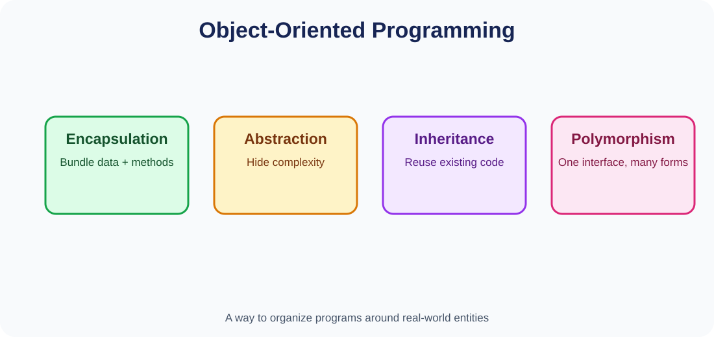
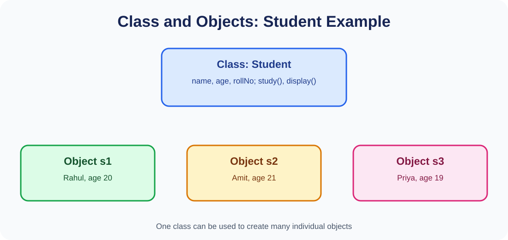
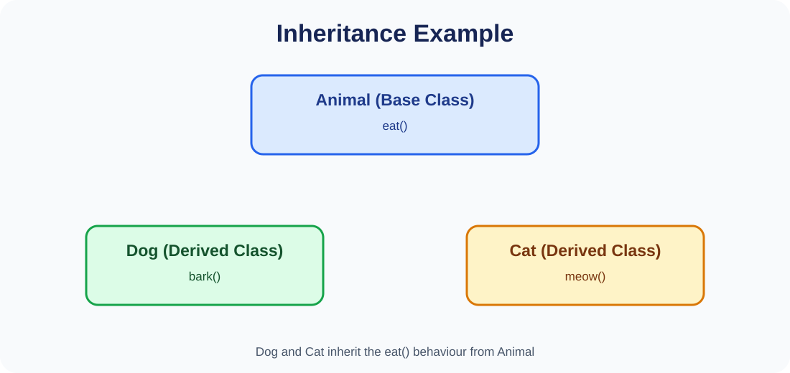
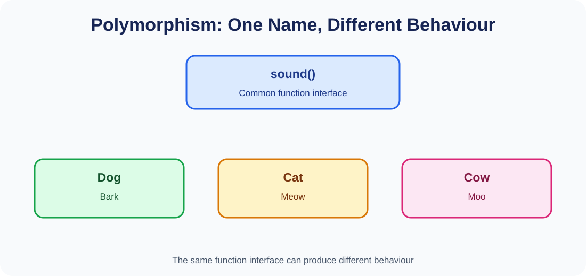

# Object-Oriented Programming (OOP) — Beginner Notes in C++

> **Audience:** Students learning OOP for the first time  
> **Language:** C++  
> **Goal:** Understand the concepts first, then learn to implement them in code.

## Learning outcomes

After completing these notes, you should be able to:

- Explain programming paradigms.
- Differentiate procedural programming and OOP.
- Explain classes and objects.
- Write simple C++ programs using classes and objects.
- Understand encapsulation, abstraction, inheritance and polymorphism.
- Use access specifiers, constructors and destructors.

---

# 1. What is programming?

Programming is the process of writing instructions that tell a computer what to do. These instructions are written using programming languages such as C, C++, Java and Python.

Example: adding two numbers.

```cpp
#include <iostream>
using namespace std;

int main() {
    int a = 10;
    int b = 20;
    int sum = a + b;

    cout << "Sum = " << sum;
    return 0;
}
```

**Output**
```text
Sum = 30
```

# 2. What is a programming paradigm?

A programming paradigm is a style or approach used to design and organize a program.

Two important approaches are:

1. Procedural Programming
2. Object-Oriented Programming

## 2.1 Procedural programming

Procedural programming organizes a program around functions or procedures. Each function performs a particular task.

For example, an ATM program may have separate functions for checking balance, depositing money, withdrawing money and changing a PIN.

```cpp
#include <iostream>
using namespace std;

void deposit() {
    cout << "Money deposited" << endl;
}

void withdraw() {
    cout << "Money withdrawn" << endl;
}

int main() {
    deposit();
    withdraw();
    return 0;
}
```

The program is organized around functions.

## 2.2 Object-Oriented Programming

Object-Oriented Programming (OOP) is a programming paradigm that organizes a program using **classes and objects**. It helps represent real-world entities by combining related data and functions.

Examples of real-world entities include students, cars, mobile phones, employees and bank accounts.

A car has **properties** such as brand, colour and speed. It also has **behaviours** such as start, stop and accelerate.



## 2.3 Why do we need OOP?

Imagine developing a college management system that stores information about hundreds or thousands of students. Managing every student's information using separate variables can become difficult.

OOP helps us:

1. Organize related data and functions together.
2. Reuse code.
3. Make programs easier to maintain.
4. Control access to data.
5. Model real-world entities.

> **Remember:** OOP is not just about writing classes. It is about organizing a program in a clear, reusable and manageable way.

# 3. Class and Object

A **class** and an **object** are the basic building blocks of OOP.

## 3.1 What is a class?

A class is a user-defined data type that acts as a blueprint or template for creating objects. It defines data members and member functions.

- **Data members:** Variables declared inside a class.
- **Member functions:** Functions declared inside a class.

### Real-world example: House blueprint

An architect creates a blueprint before constructing a house. The blueprint describes the structure. Multiple houses can be constructed using the same blueprint.

Similarly, a class defines a structure, and objects are created using that class.

## 3.2 What is an object?

An object is an **instance of a class**. It represents an entity created using the class.

For example, `Student` can be a class. Rahul, Amit and Priya can be individual objects of that class.



## 3.3 Class syntax in C++

```cpp
class ClassName {
public:
    // Data members
    // Member functions
};
```

Important points:

- The `class` keyword declares a class.
- The class body is enclosed in curly braces `{ }`.
- A semicolon is required after the closing brace of a class.

## 3.4 First class and object program

```cpp
#include <iostream>
#include <string>
using namespace std;

class Student {
public:
    string name;
    int age;

    void display() {
        cout << "Name: " << name << endl;
        cout << "Age: " << age << endl;
    }
};

int main() {
    Student s1;

    s1.name = "Rahul";
    s1.age = 20;

    s1.display();

    return 0;
}
```

**Output**
```text
Name: Rahul
Age: 20
```

### Explanation

1. `class Student` declares a class named `Student`.
2. `name` and `age` are data members.
3. `display()` is a member function.
4. `Student s1;` creates an object named `s1`.
5. `s1.name` and `s1.age` access public members using the dot (`.`) operator.
6. `s1.display()` calls the member function.

## 3.5 Creating multiple objects

One class can be used to create multiple objects. Each object has its own set of non-static data members.

```cpp
#include <iostream>
#include <string>
using namespace std;

class Student {
public:
    string name;
    int age;

    void display() {
        cout << name << " - " << age << endl;
    }
};

int main() {
    Student s1, s2;

    s1.name = "Rahul";
    s1.age = 20;

    s2.name = "Amit";
    s2.age = 21;

    s1.display();
    s2.display();

    return 0;
}
```

**Output**
```text
Rahul - 20
Amit - 21
```

Both objects belong to the same class, but they store different values.

## 3.6 Class vs Object

| Class | Object |
|---|---|
| A blueprint or template | An instance of a class |
| Defines data and functions | Has actual data values |
| Example: `Student` | Example: `s1`, `s2` |
| One class can create many objects | Each object is created from a class |

# 4. The four pillars of OOP

The four commonly taught pillars of OOP are:

1. Encapsulation
2. Abstraction
3. Inheritance
4. Polymorphism


## 4.1 Encapsulation

**Definition:** Encapsulation is the process of combining data members and the functions that operate on that data into a single unit, a class. It also allows us to control access to class members.

**Real-world analogy:** A medicine capsule contains medicine inside its outer covering. Similarly, a class groups related data and functions together.

### C++ example

```cpp
#include <iostream>
using namespace std;

class BankAccount {
private:
    int balance = 5000;

public:
    void showBalance() {
        cout << "Balance: " << balance << endl;
    }
};

int main() {
    BankAccount account;
    account.showBalance();
    return 0;
}
```

**Output**
```text
Balance: 5000
```

Here, `balance` is private, so it cannot be accessed directly using the object from `main()`. The public function `showBalance()` provides controlled access to it.

**Key point:** Encapsulation combines data and related functions and supports controlled access to data.

## 4.2 Abstraction

**Definition:** Abstraction means showing essential functionality while hiding unnecessary implementation details.

**Real-world example:** When using an ATM, you select an operation such as withdrawing money. You do not need to know all the internal steps through which the ATM communicates with the bank.

### Simple C++ illustration

```cpp
#include <iostream>
using namespace std;

class ATM {
public:
    void withdrawMoney() {
        // Internal steps can be implemented here.
        cout << "Withdrawal request processed" << endl;
    }
};

int main() {
    ATM atm;
    atm.withdrawMoney();
    return 0;
}
```

The user calls `withdrawMoney()` without needing to know its internal implementation.

> **Note:** This example illustrates the idea of abstraction. C++ also supports abstraction through abstract classes and pure virtual functions, which can be studied later.

## 4.3 Inheritance

**Definition:** Inheritance is an OOP feature in which a derived class acquires accessible members of a base class. It supports code reuse.

**Real-world analogy:** A child may inherit certain characteristics from their parents. In programming, a derived class can inherit features from a base class.

- **Base class:** The class whose features are inherited.
- **Derived class:** The class that inherits from another class.
- **Parent class:** Another name for a base class.
- **Child class:** Another name for a derived class.



### C++ example

```cpp
#include <iostream>
using namespace std;

class Animal {
public:
    void eat() {
        cout << "Animal is eating" << endl;
    }
};

class Dog : public Animal {
public:
    void bark() {
        cout << "Dog is barking" << endl;
    }
};

int main() {
    Dog d1;
    d1.eat();
    d1.bark();
    return 0;
}
```

**Output**
```text
Animal is eating
Dog is barking
```

Explanation:

- `Animal` is the base class.
- `Dog` is the derived class.
- `class Dog : public Animal` declares public inheritance.
- The `Dog` object can call the inherited public function `eat()` and its own function `bark()`.

### Types of inheritance in C++

1. **Single inheritance:** One derived class inherits from one base class.
2. **Multiple inheritance:** One derived class inherits from more than one base class.
3. **Multilevel inheritance:** A class is derived from another derived class.
4. **Hierarchical inheritance:** Multiple derived classes inherit from one base class.
5. **Hybrid inheritance:** A combination of two or more inheritance types.

## 4.4 Polymorphism

**Definition:** Polymorphism means **one name, many forms**. It allows the same function name or interface to behave differently in different situations.

**Real-world example:** The same person can have different roles, such as student, employee and family member.



### Types of polymorphism

1. Compile-time polymorphism
2. Run-time polymorphism

### A. Compile-time polymorphism

Compile-time polymorphism is commonly demonstrated using function overloading and operator overloading.

#### Function overloading

When multiple functions in the same scope have the same name but different parameter lists, it is called function overloading.

```cpp
#include <iostream>
using namespace std;

class Calculator {
public:
    int add(int a, int b) {
        return a + b;
    }

    int add(int a, int b, int c) {
        return a + b + c;
    }
};

int main() {
    Calculator c1;
    cout << c1.add(10, 20) << endl;
    cout << c1.add(10, 20, 30) << endl;
    return 0;
}
```

**Output**
```text
30
60
```

The compiler selects the matching `add()` function based on the arguments.

**Note:** Changing only the return type is not sufficient to overload a function.

### B. Run-time polymorphism

Run-time polymorphism in C++ is commonly achieved using function overriding with virtual functions.

#### Function overriding

When a derived class provides its own implementation of a virtual function declared in the base class, it is called function overriding.

```cpp
#include <iostream>
using namespace std;

class Animal {
public:
    virtual void sound() {
        cout << "Animal makes a sound" << endl;
    }
};

class Dog : public Animal {
public:
    void sound() override {
        cout << "Dog barks" << endl;
    }
};

int main() {
    Animal* a;
    Dog d;

    a = &d;
    a->sound();

    return 0;
}
```

**Output**
```text
Dog barks
```

Explanation:

- `virtual` enables dynamic dispatch for this member function.
- `Animal* a` is a base-class pointer.
- `a = &d` makes the pointer refer to the `Dog` object.
- `a->sound()` calls the overridden `Dog::sound()` function at run time.

# 5. Access specifiers in C++

Access specifiers control the accessibility of class members.

C++ has three main access specifiers:

| Access specifier | Inside its class | Outside the class | In a derived class |
|---|---|---|---|
| `public` | Yes | Yes | Yes, subject to inheritance access |
| `private` | Yes | No | No direct access |
| `protected` | Yes | No | Yes, subject to inheritance access |

Example:

```cpp
class Student {
public:
    string name;

private:
    int age;

protected:
    int marks;
};
```

- **Public:** Accessible from outside the class through an object.
- **Private:** Accessible directly within the class and by its friends.
- **Protected:** Accessible within the class, its friends and derived classes, subject to C++ access rules.

**Important:** Members of a C++ `class` are private by default. Members of a `struct` are public by default.

# 6. Constructors

A constructor is a special member function that is automatically called when an object is created.

### Characteristics

- Its name is the same as the class name.
- It has no return type, not even `void`.
- It is called automatically during object initialization.
- It is commonly used to initialize data members.

## 6.1 Default constructor

A constructor that can be called without arguments is called a default constructor.

```cpp
#include <iostream>
using namespace std;

class Student {
public:
    Student() {
        cout << "Constructor called" << endl;
    }
};

int main() {
    Student s1;
    return 0;
}
```

**Output**
```text
Constructor called
```

## 6.2 Parameterized constructor

A constructor that accepts parameters is called a parameterized constructor.

```cpp
#include <iostream>
#include <string>
using namespace std;

class Student {
public:
    string name;
    int age;

    Student(string n, int a) {
        name = n;
        age = a;
    }

    void display() {
        cout << name << " " << age << endl;
    }
};

int main() {
    Student s1("Rahul", 20);
    s1.display();
    return 0;
}
```

**Output**
```text
Rahul 20
```

## 6.3 Copy constructor

A copy constructor creates a new object using another object of the same class.

```cpp
#include <iostream>
using namespace std;

class Number {
public:
    int value;

    Number(int v) {
        value = v;
    }

    Number(const Number& obj) {
        value = obj.value;
    }
};

int main() {
    Number n1(100);
    Number n2(n1);

    cout << n2.value << endl;
    return 0;
}
```

**Output**
```text
100
```

# 7. Destructor

A destructor is a special member function that is automatically called when an object is destroyed.

### Characteristics

- Its name is the class name preceded by `~`.
- It has no return type.
- It takes no parameters.
- A class has only one destructor.
- It is commonly used to release resources owned by an object.

```cpp
#include <iostream>
using namespace std;

class Student {
public:
    Student() {
        cout << "Object created" << endl;
    }

    ~Student() {
        cout << "Object destroyed" << endl;
    }
};

int main() {
    Student s1;
    return 0;
}
```

**Output**
```text
Object created
Object destroyed
```

For this local object, the destructor is called when its lifetime ends, as `main()` exits.

# 8. Quick revision

| Concept | Meaning |
|---|---|
| Class | Blueprint for creating objects |
| Object | Instance of a class |
| Data member | Variable declared inside a class |
| Member function | Function declared inside a class |
| Encapsulation | Combining data and related functions, with controlled access |
| Abstraction | Hiding implementation details and exposing essential functionality |
| Inheritance | Deriving a class from another class |
| Polymorphism | One interface or name with different behaviours |
| Constructor | Special function called during object initialization |
| Destructor | Special function called when an object's lifetime ends |
| Access specifier | Controls accessibility of class members |

# 9. Practice questions

## A. Conceptual questions

1. What is programming?
2. What is a programming paradigm?
3. What is the difference between procedural programming and OOP?
4. What is a class?
5. What is an object?
6. Can one class create multiple objects?
7. What are data members and member functions?
8. What are the four pillars of OOP?
9. What is the difference between encapsulation and abstraction?
10. What is inheritance?
11. What is polymorphism?
12. What is function overloading?
13. What is function overriding?
14. What is a constructor?
15. What is a destructor?
16. What are access specifiers?
17. What is the purpose of the `virtual` keyword?
18. What is the difference between a base class and a derived class?

## B. Programming exercises

| Level | Task |
|---|---|
| 1 | Create a `Student` class with name and age. Display the details. |
| 2 | Create two objects of the `Student` class and display both students' details. |
| 3 | Create an `Employee` class with ID, name and salary. |
| 4 | Create a `Rectangle` class and calculate its area. |
| 5 | Create a `BankAccount` class with deposit and withdraw functions. |
| 6 | Demonstrate encapsulation using a private data member. |
| 7 | Demonstrate single inheritance using `Animal` and `Dog`. |
| 8 | Demonstrate function overloading using a `Calculator` class. |
| 9 | Demonstrate a default and parameterized constructor. |
| 10 | Demonstrate a destructor. |
| 11 | Demonstrate function overriding using a virtual function. |
| 12 | Create a simple student management program using classes and objects. |

# 10. Suggested learning order

| Session | Topics |
|---|---|
| 1 | Programming paradigms and introduction to OOP |
| 2 | Classes and objects |
| 3 | Multiple objects and member functions |
| 4 | Access specifiers |
| 5 | Encapsulation and abstraction |
| 6 | Constructors |
| 7 | Destructors |
| 8 | Inheritance |
| 9 | Types of inheritance |
| 10 | Polymorphism and function overloading |
| 11 | Function overriding and virtual functions |
| 12 | Revision and mini project |

---

## Final advice for students

Do not try to memorize all OOP definitions at once. Understand the real-world examples, trace the code line by line, write the programs yourself and practise creating your own classes.

**The best way to learn OOP is to understand how data and behaviour work together through classes and objects.**
